# Multi-Mode Robotic Arm

Voice-controlled 6-DOF arm. Say **"pick, red box, yes"**: a depth camera finds the block, the STM32 solves IK, and the arm places it on your hand.


<p align="center">
  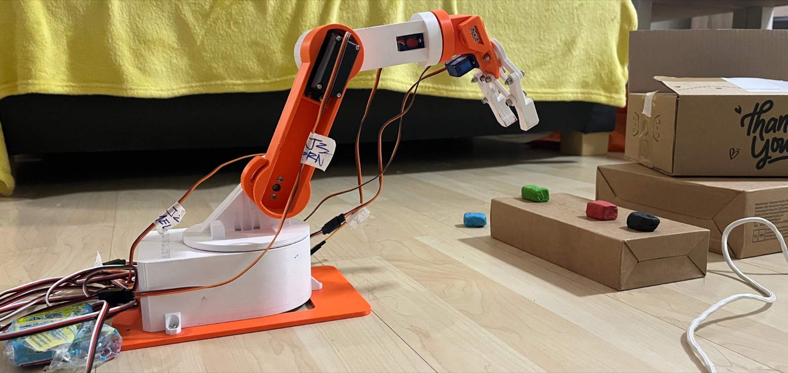
</p>

<p align="center">
  <a href="https://youtu.be/xyfyx_k8d-4"><b>▶ Demo video</b></a> ·
  <a href="https://github.com/georgielovejuice/stm32-robotic-arm/releases/latest/download/final-report.pdf"><b>📄 Report</b></a>
</p>

## Features

- **On-chip keyword spotting**: CNN (X-CUBE-AI) on 2× INMP441 I²S mics, 21 words, ~43 ms per inference
- **Closed-form IK + FK**: four modes: Voice, Cartesian, Joint Group, Single-Joint
- **Depth vision**: RealSense D435 on a Pi 4, RANSAC table plane + height/colour segmentation
- **Camera → robot calibration**: Kabsch/SVD, 8.9 mm RMS
- **50 Hz motion pipeline**: trapezoidal ramps, synchronised joints, joint limits
- **Bare-metal firmware**: ISR + main loop, event queue, DMA for audio, ADC and UART

## Architecture

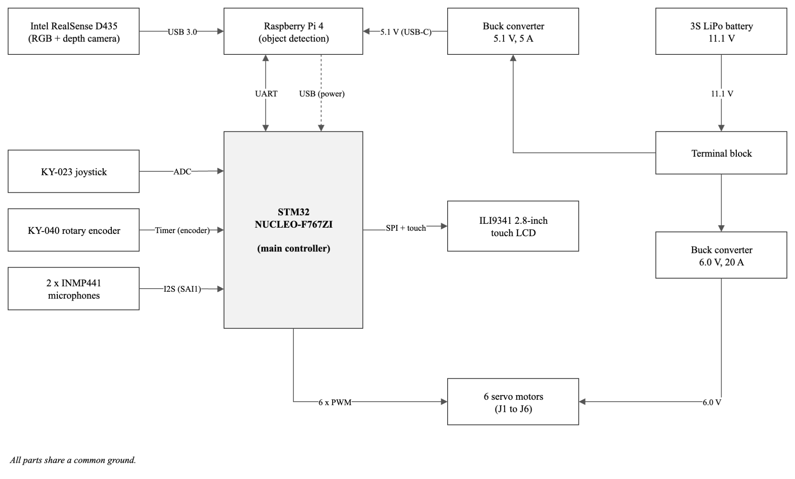

```text
STM32 → Pi   FIND red_box
Pi → STM32   OBJ red_box 240 12 30     # mm, robot frame, 6–11 ms reply
```

## Vision

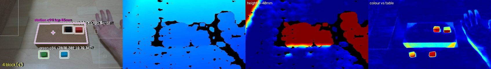
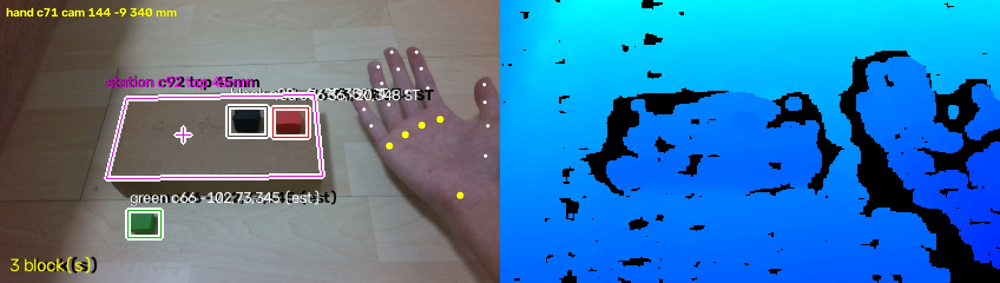

## Hardware

| | |
|---|---|
| 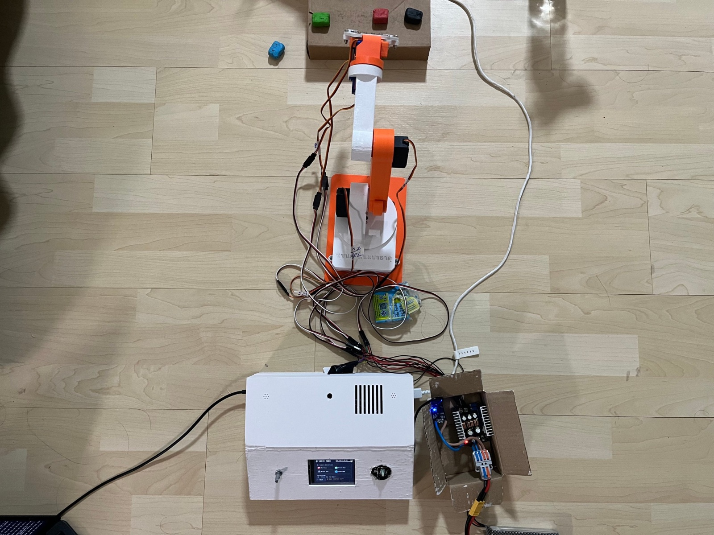 | 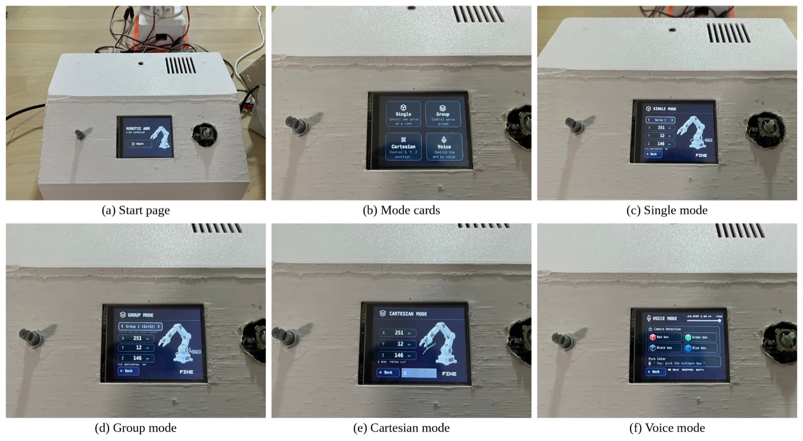 |
| 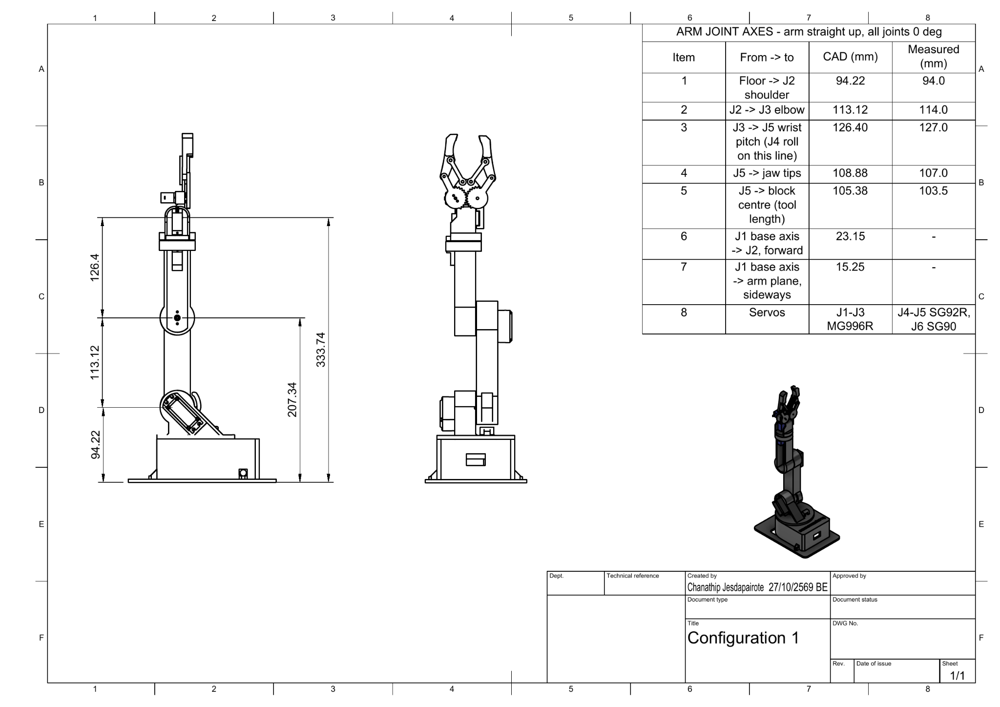 | 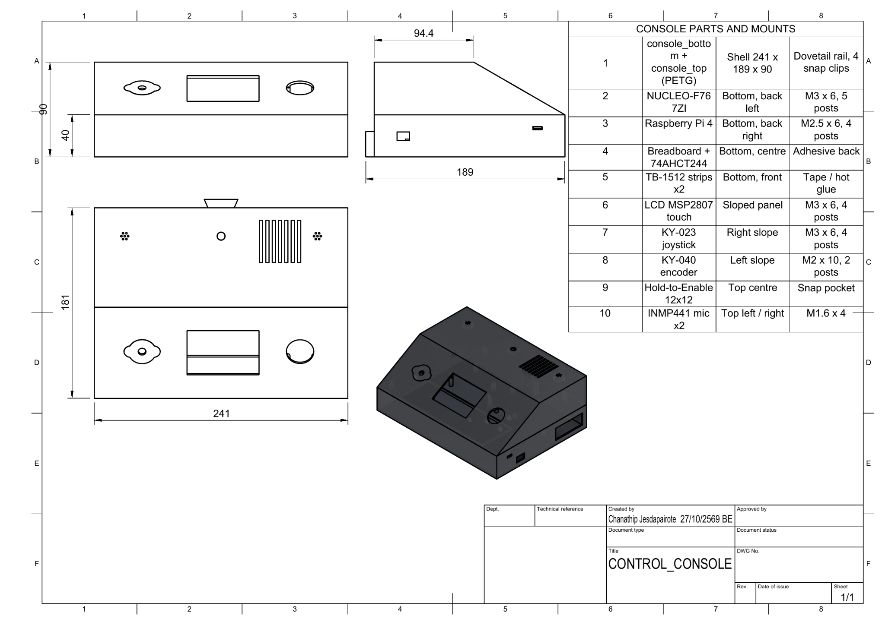 |

NUCLEO-F767ZI · Pi 4 + D435 · 3× MG996R + 3× SG92R · ILI9341 touch LCD · KY-023 + KY-040 · 3S LiPo → 6.0 V / 5.1 V bucks

<details>
<summary>Flowchart, voice state machine, wiring</summary>

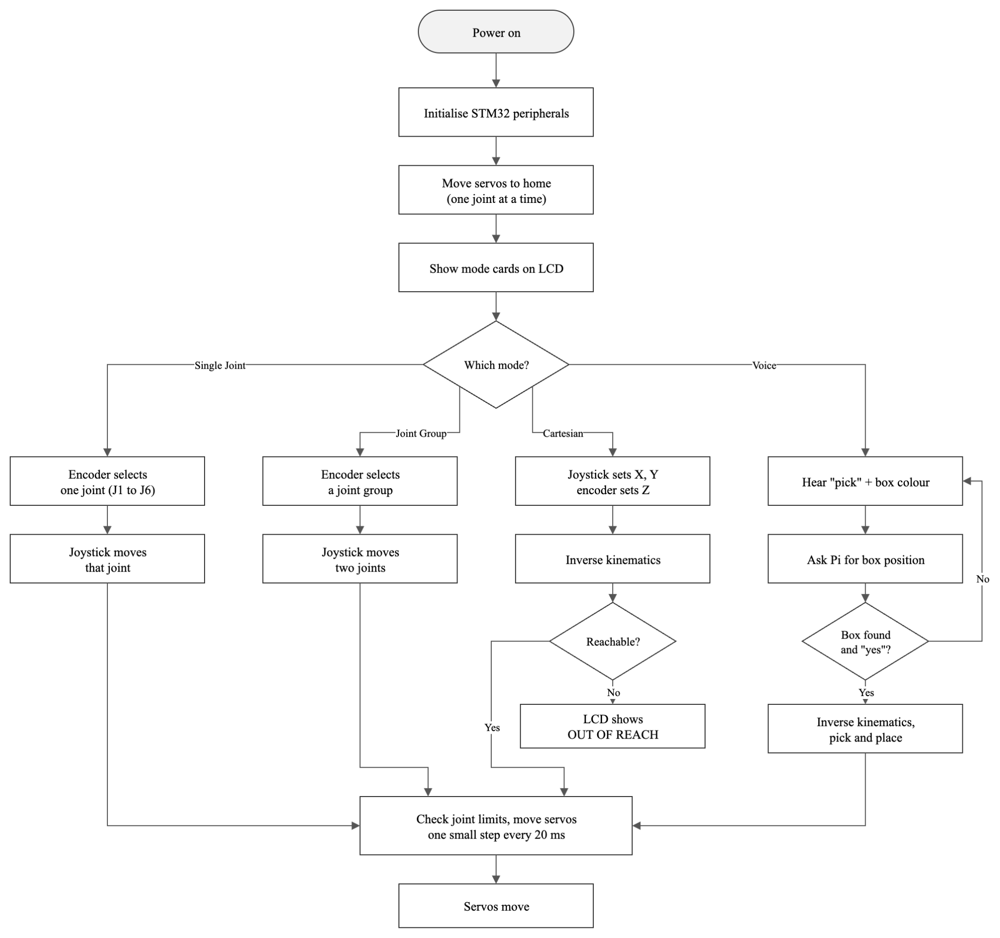
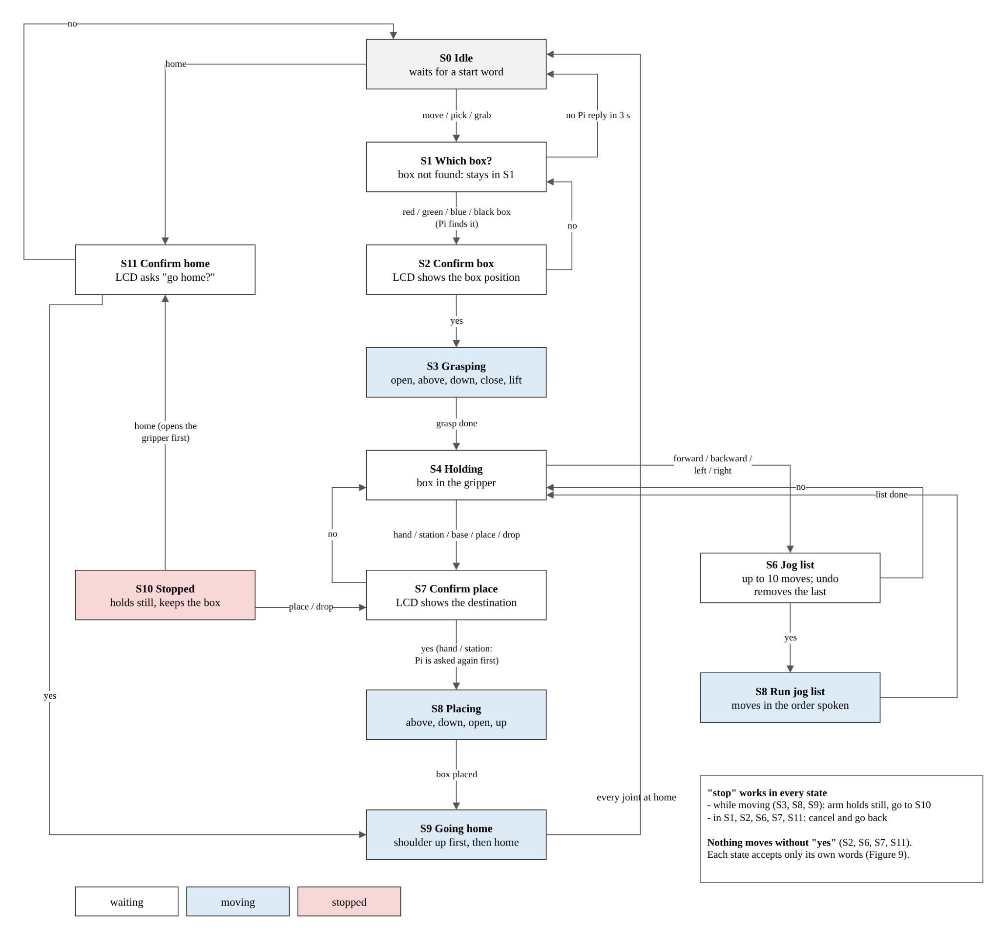
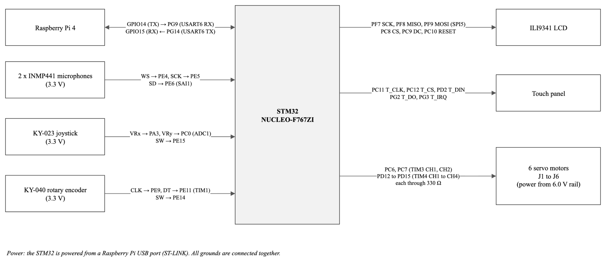
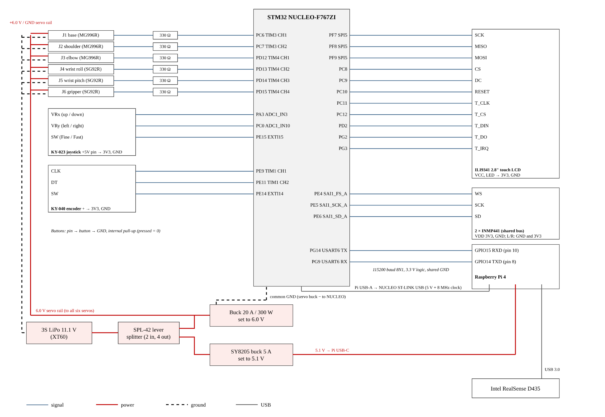

</details>

## Results

| Metric | Result |
|---|---|
| Voice command accuracy | 75–99% confidence, 0 false accepts |
| Positioning (calibration RMS) | 8.9 mm |
| Grasp success | ~75–80% |
| Consecutive pick-and-place | 7–8 / 10 (all misses came from camera calibration) |

## Build

```sh
python ProjectDevGuide/ci/build_firmware.py   # STM32CubeIDE 2.2 toolchain, 0 warnings
sh ProjectDevGuide/tests/host/run.sh          # host tests
```

Firmware in `RoboticArmMain/App/`, Pi code in `ProjectDevGuide/tools/pi/`.

---

KMITL Microcontroller Interfacing 2026, team of 7. Forked from [Potaeeatsthis/2026-micro-con](https://github.com/Potaeeatsthis/2026-micro-con). Arm based on [OmArTronics 6-DOF](https://omartronics.com/diy-6-dof-robotic-arm-build/).
